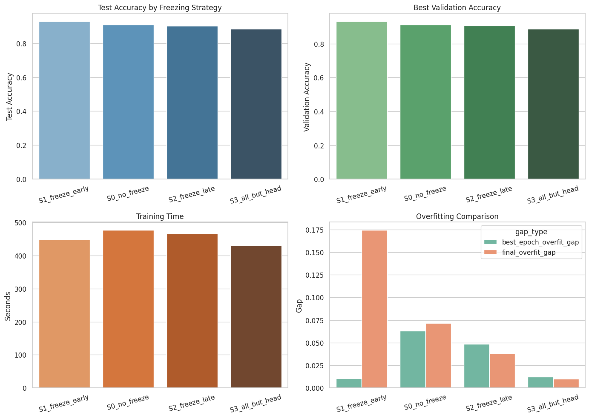
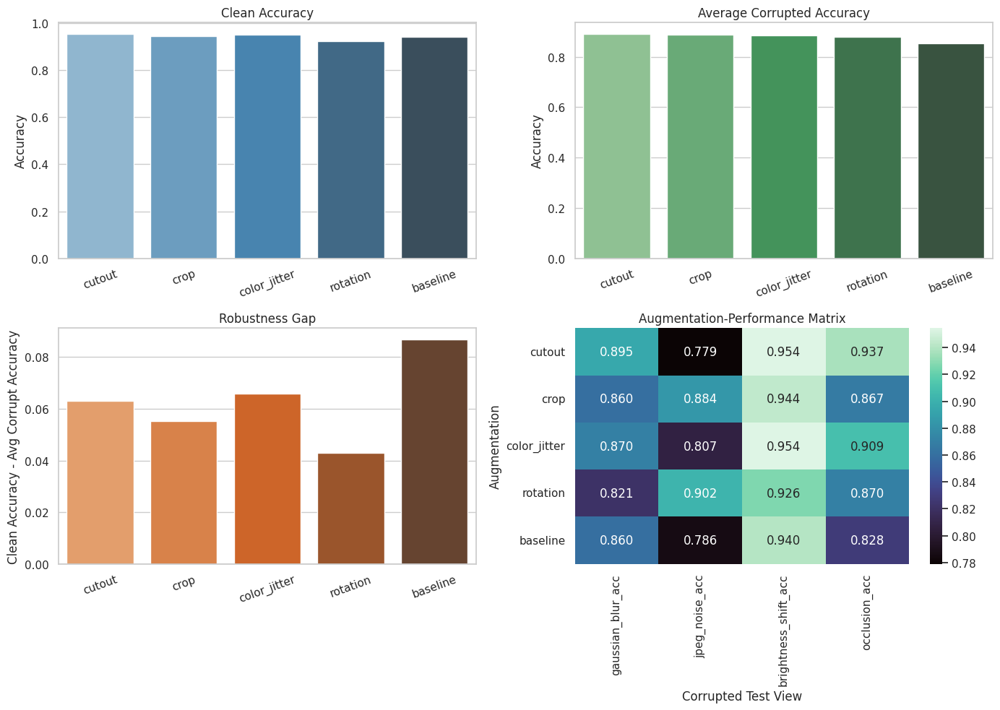
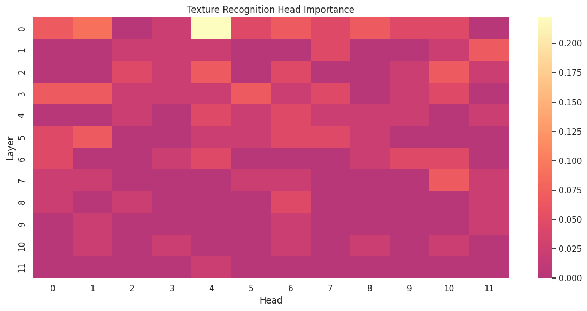

# Crowd Density Classification for Indian Railway Stations

Deep-learning experiments on classifying images of Indian railway stations and platforms into **low / medium / high crowd density**, the kind of signal a crowd-management system could use to judge how severe a situation is.

This repository holds three studies on the same dataset, done as part of the *Deep Learning for Computer Vision* course (LNMIIT, Phase 2, April 2026):

| # | Study | Model | Question |
|---|-------|-------|----------|
| 1 | [Transfer-learning layer freezing](notebooks/01_transfer_learning_layer_freezing.ipynb) | ResNet-50 | Which layers should be frozen when fine-tuning on a small dataset? |
| 2 | [Data augmentation as inductive bias](notebooks/02_augmentation_robustness.ipynb) | ResNet-18 | Which augmentation makes the classifier robust to which corruption? |
| 3 | [ViT attention-head ablation](notebooks/03_vit_attention_head_ablation.ipynb) | ViT-B/16 | Which attention heads matter for texture, shape and spatial cues? |

[](https://colab.research.google.com/github/arjitMathur/crowd-density-vision/blob/main/notebooks/01_transfer_learning_layer_freezing.ipynb)
[](https://colab.research.google.com/github/arjitMathur/crowd-density-vision/blob/main/notebooks/02_augmentation_robustness.ipynb)
[](https://colab.research.google.com/github/arjitMathur/crowd-density-vision/blob/main/notebooks/03_vit_attention_head_ablation.ipynb)

## Dataset

About 1,900 images of Indian railway stations and platforms, sorted into three folders by crowd density (`low_new1`, `medium_new1`, `high_new1`). All notebooks use the same stratified split (seed 42): **1,332 train / 285 validation / ~285 test**, with class-weighted cross-entropy to handle imbalance (low 46%, medium 30%, high 23%).

The images are **not included** in this repository. See [DATA.md](DATA.md) for the expected folder layout.

## Results

All numbers come from the saved outputs in the notebooks (single run, seed 42, GPU). With ~285 test images, **one image is about 0.35 percentage points**, so gaps of 1-2 points are within noise.

### 1. Layer freezing (ResNet-50, 15 epochs)

| Strategy | Frozen | Best val acc | Test acc | Time (s) |
|---|---|---|---|---|
| **S1 freeze early** | conv1, layer1, layer2 | 93.3% | **93.0%** | 449 |
| S0 no freezing | none | 91.2% | 90.9% | 477 |
| S2 freeze late | layer3, layer4 | 90.9% | 90.2% | 467 |
| S3 head only | everything but `fc` | 88.8% | 88.5% | 432 |



### 2. Augmentation robustness (ResNet-18, 5 epochs)

Test accuracy on the clean test set and on four corrupted copies of it:

| Augmentation | Clean | Blur | Noise* | Brightness | Occlusion | Avg. corrupted |
|---|---|---|---|---|---|---|
| Cutout | **95.4%** | **89.5%** | 77.9% | **95.4%** | **93.7%** | **89.1%** |
| Crop | 94.4% | 86.0% | 88.4% | 94.4% | 86.7% | 88.9% |
| Color jitter | 95.1% | 87.0% | 80.7% | **95.4%** | 90.9% | 88.5% |
| Rotation | 92.3% | 82.1% | **90.2%** | 92.6% | 87.0% | 88.0% |
| Baseline | 94.0% | 86.0% | 78.6% | 94.0% | 82.8% | 85.4% |

\*The "noise" corruption adds Gaussian pixel noise (it is called `jpeg_noise` in the code but is not JPEG compression).



### 3. Attention-head ablation (ViT-B/16, 5 epochs)

| Probe | What it does | Accuracy | Macro F1 |
|---|---|---|---|
| Clean | original image | 95.1% | 0.950 |
| Texture | patch shuffle (global layout destroyed, local texture kept) | 92.6% | 0.928 |
| Shape | binary edge map (texture removed) | 44.6% | 0.339 |
| Spatial | occlusion-sensitivity quadrant vs. an edge-density heuristic | 45.8% | n/a |

Most sensitive single heads (head replaced by uniform attention, 45-image probe subset):

| Probe | Layer, head | Accuracy drop |
|---|---|---|
| Texture | L0, H4 | 22.2 points (10 of 45 images) |
| Spatial | L0, H1 | 13.6 points (3 of 22 samples) |
| Shape | L4, H7 | 4.4 points (2 of 45 images) |



## What the experiments suggest

- **Freezing the early ResNet-50 layers gave the best test accuracy** (about 2 points above full fine-tuning, roughly 6 images). Full fine-tuning's validation accuracy was erratic (it dropped to 55.8% at epoch 4), though that run used a fairly high learning rate (Adam, 1e-3), so the instability may not be caused by the number of trainable parameters alone.
- **No augmentation won everywhere.** Cutout helped most against occlusion (+10.9 points over baseline) and blur, rotation helped most against pixel noise (+11.6 points) and had the smallest clean-to-corrupted gap, and Cutout was the worst on noise. The three best augmentations are within 0.6 points on average corrupted accuracy.
- **The fine-tuned ViT relies on local appearance rather than global layout**: it keeps 92.6% accuracy when patches are shuffled but on edge maps it does no better than always guessing the majority class (44.6% vs. 46% for "low"), and it classifies none of the "high" images correctly. The edge-map result also reflects distribution shift, because the model never saw such images.
- **The medium class is the hardest** in every configuration reported: it has the lowest F1 in all clean-test reports, and under occlusion most of the confident errors were medium images predicted as low.

## Limitations

- Single seed, single split, small test set. Differences between the top strategies are not statistically established.
- The head-ablation sweep uses only 45 probe images (15 per class); the spatial score uses 22. Only the texture result (L0H4) is clearly above noise.
- The "spatial" ground truth is an edge-density heuristic, not human annotation.
- Corrupted test sets use random transforms, so re-running gives slightly different numbers.
- One image in the `high` folder (`1894_2.png`) is unreadable and is skipped.
- The dataset is small and comes from one source, so these results say little about other stations, camera angles or lighting.

## Repository layout

```
.
├── notebooks/
│   ├── 01_transfer_learning_layer_freezing.ipynb
│   ├── 02_augmentation_robustness.ipynb
│   └── 03_vit_attention_head_ablation.ipynb
├── results/figures/      # plots exported from the notebook outputs
├── docs/REPORT.md        # full write-up of the three studies
├── DATA.md               # dataset layout and notes
├── requirements.txt
└── LICENSE
```

Notebook outputs (tables and plots) are saved in the notebooks. Image grids of dataset photos were removed from the saved outputs.

## Running

1. Put the images in `data/data/{high_new1,low_new1,medium_new1}/` (see [DATA.md](DATA.md)).
2. `pip install -r requirements.txt`
3. Open a notebook with Jupyter or Colab and run all cells. A GPU is strongly recommended (each notebook took several minutes to tens of minutes on a Colab GPU).

Notebook 03 patches the internals of Hugging Face's ViT attention module, so it can break on a different `transformers` version than the one used in the original run.

## Authors

Arjit Mathur, Poorav Satija, Garvit Goyal, Divyansh Garg, Laveesh Chanchlani (LNMIIT, B.Tech CSE).

## License

Code is released under the [MIT License](LICENSE). The dataset is not covered by this license.
